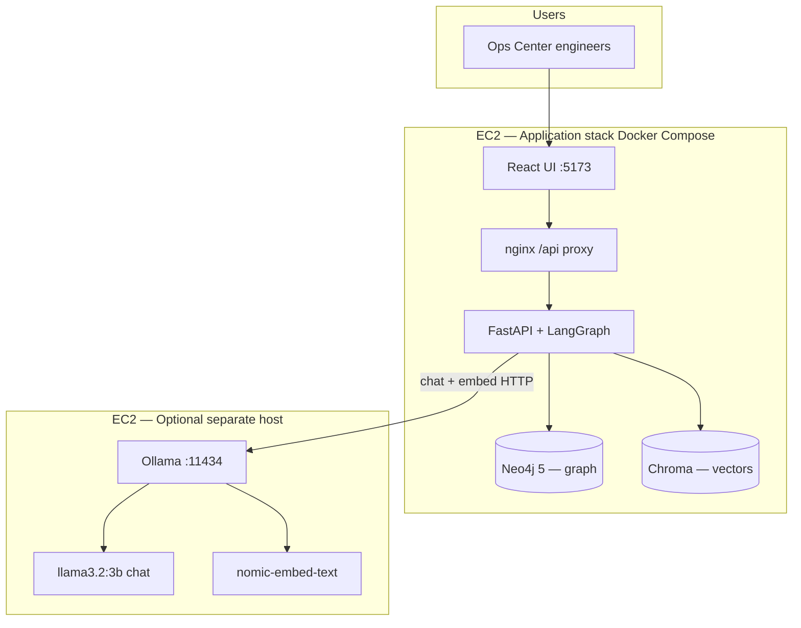
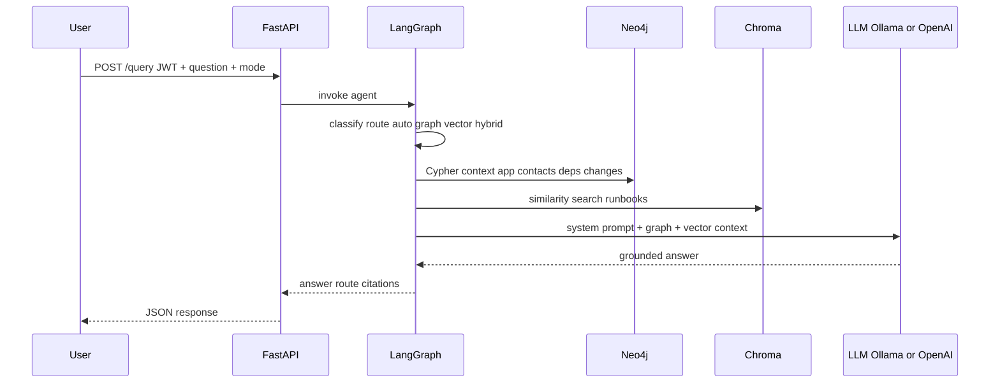

# Ops Center GraphRAG — Organizational Knowledge for Incident Response

**One-liner:** This RAG app helps **Ops Center engineers** answer **incident routing, blast-radius, escalation, and change-correlation questions** from an **enterprise application dependency graph + runbooks** in a **web chat UI**, with **≥85% faithfulness** on a golden eval set (target **&lt;8s** p95 latency on EC2 `t3.large`).

## Use case (Project 3 — GraphRAG for Organizational Knowledge)

Enterprise command center with hundreds of applications. Ops needs:

- **Who to contact** when an application has an incident
- **Downstream impact** via dependency edges
- **SME / escalation report structure** for handoffs
- **Change requests** in flight that may explain an incident (acknowledge / link)

Traditional vector RAG misses relationship questions (“who owns X and what depends on it?”). **GraphRAG** (Neo4j + Cypher) handles structure; **vector RAG** (Chroma) handles unstructured runbook text. LangGraph orchestrates routing, retrieval, and grounded answers.

## High-level design

### System context

Ops Center engineers use a **web chat** during incidents. Questions mix **relationship facts** (ownership, dependencies, changes, escalation contacts) and **procedural text** (runbooks, SME report templates). The system answers from an **organizational knowledge graph** plus a **runbook vector index**, grounded by a **local or cloud LLM**.

### Logical architecture



| Component | Responsibility |
|-----------|----------------|
| **React UI** | Login, chat, mode selector (`auto` / `graph` / `vector`) |
| **nginx (frontend container)** | Static UI; reverse-proxy `/api` → FastAPI |
| **FastAPI** | JWT auth, `/query`, health |
| **LangGraph agent** | Route → graph retrieve → vector retrieve → generate |
| **Neo4j** | 100 apps, stakeholders, dependencies, changes, escalation ladder |
| **Chroma** | Embedded runbook chunks from `data/runbooks/` |
| **Ollama (optional)** | Local LLM + embeddings on same or separate EC2 ([docs/ollama-ec2.md](docs/ollama-ec2.md)) |
| **OpenAI (optional)** | Cloud LLM/embeddings via `LLM_PROVIDER=openai` |

### Query pipeline (LangGraph)



1. **Classify** — Heuristics (or forced mode) pick `graph`, `vector`, or `hybrid`.  
2. **Graph retrieve** — App name detection → ownership, SME/Eng Mgr/PM/Director, `DEPENDS_ON`, active `ChangeRequest`.  
3. **Vector retrieve** — Top-k chunks from Chroma (troubleshooting, L1/L2 procedures).  
4. **Generate** — LLM must cite `[Graph]` / `[Vector]`; refuse if context is insufficient.

### Graph data model (Neo4j)

| Node | Key properties |
|------|----------------|
| `Application` | `name`, `description`, `domain`, `tier`, `criticality` |
| `Person` | `name`, `email`, `role`, `title` |
| `Team` | `name` (domain / owning team) |
| `ChangeRequest` | `id`, `title`, `status`, `ack_ticket`, … |
| `EscalationLevel` | `level`, `sla_minutes`, `required_fields` |

| Relationship | Meaning |
|--------------|---------|
| `(Team)-[:OWNS]->(Application)` | Owning org |
| `(Person)-[:SME_FOR\|ENG_MANAGER_FOR\|PRODUCT_MANAGER_FOR\|DIRECTOR_FOR]->(Application)` | Stakeholder map |
| `(Application)-[:DEPENDS_ON]->(Application)` | Blast radius |
| `(ChangeRequest)-[:AFFECTS]->(Application)` | In-flight change correlation |
| `(Person)-[:PRIMARY_CONTACT_FOR]->(Application)` | Ops on-call overlay |

**Source of truth:** `data/graph/applications_catalog.json` (100 apps) + CSV export → loaded by `python -m app.scripts.seed_all`.

### Vector corpus & ingestion

| Stage | Implementation |
|-------|----------------|
| Corpus | Markdown runbooks under `data/runbooks/` |
| Load | YAML front matter → metadata (`application`, `title`) |
| Chunk | Heading-aware splitter (~600 chars) |
| Embed | Ollama `nomic-embed-text` or OpenAI `text-embedding-3-small` |
| Store | Chroma collection `ops_runbooks` (Docker volume `chroma_data`) |
| Refresh | `python -m app.scripts.ingest_runbooks` or `seed_all` |

Details: [docs/ingestion.md](docs/ingestion.md).

### Security & access

- **Authentication** — JWT after login; 5 demo ops users (`backend/app/auth.py`).  
- **Network** — Public: **5173** (UI) only; Neo4j **7474/7687** private; Ollama **11434** VPC-only if remote.  
- **Grounding** — System prompt restricts answers to retrieved context.

### Deployment topology (reference)

Typical course / lab layout:

| Host | Role | Services |
|------|------|----------|
| `10.135.128.5` (example) | App stack | `docker compose`: frontend, api, neo4j |
| `10.135.128.9` (example) | LLM | `systemd` Ollama: `llama3.2:3b`, `nomic-embed-text` |

`backend/.env` on the app host:

```env
LLM_PROVIDER=ollama
EMBEDDING_PROVIDER=ollama
OLLAMA_BASE_URL=http://10.135.128.9:11434
```

After code changes: **`docker compose build --no-cache api`** (not only `up --force-recreate`).

### Repository map

| Path | Purpose |
|------|---------|
| `frontend/` | React chat UI |
| `backend/app/rag/graph_agent.py` | LangGraph workflow |
| `backend/app/graph/` | Neo4j client, retriever, catalog seed |
| `backend/app/ingestion/` | Runbook → Chroma pipeline |
| `data/graph/` | 100-app JSON + CSV reference |
| `data/runbooks/` | Troubleshooting markdown |
| `eval/golden_dataset.json` | Graph vs vector eval cases |
| `docs/ec2-deploy.md` | Amazon Linux 2023 deploy |
| `docs/ollama-ec2.md` | Ollama + Docker wiring |

### Technology stack

| Layer | Choice |
|-------|--------|
| Graph | Neo4j 5 Community |
| Vector | Chroma (persisted) |
| Orchestration | LangChain + LangGraph |
| API | FastAPI + uvicorn |
| UI | React + Vite + nginx |
| LLM / embeddings | Ollama (default lab) or OpenAI |
| Deploy | Docker Compose on Amazon Linux 2023 |

## Quick start (local)

### Prerequisites

- Docker & Docker Compose
- **OpenAI API key**, or **Ollama** on the host ([docs/ollama-ec2.md](docs/ollama-ec2.md))

### Run

```bash
# From repo root (ops-center/), not backend/
cp backend/.env.example backend/.env
# Edit backend/.env — set OPENAI_API_KEY, JWT_SECRET, NEO4J_PASSWORD

docker compose up --build
```

- **UI:** http://localhost:5173  
- **API:** http://localhost:8000/docs  
- **Neo4j Browser:** http://localhost:7474 (user `neo4j`, password from `.env`)

### Seed graph (20+ nodes) and vector corpus

```bash
docker compose exec api python -m app.scripts.seed_all
```

### Runbook ingestion (vector DB)

Troubleshooting and procedure docs live in **`data/runbooks/`** as Markdown (optional YAML front matter). The ingestion layer loads, cleans, splits by headings, embeds, and **rebuilds** the Chroma collection (no duplicate chunks on re-run).

```bash
# After editing or adding runbooks — re-index only vectors
docker compose exec api python -m app.scripts.ingest_runbooks

# Local (from backend/, with venv + OPENAI_API_KEY)
PYTHONPATH=. python -m app.scripts.ingest_runbooks
```

Example prompts (use **Vector** or **Auto** mode): “How do I troubleshoot PaymentGateway 502 errors?” or “What is the OrderService dependency check order?”

### Sample logins (change passwords in production)

| Username | Password | Role |
|----------|----------|------|
| ops.alice | OpsCenter2026! | lead |
| ops.bob | OpsCenter2026! | engineer |
| ops.carol | OpsCenter2026! | engineer |
| ops.dave | OpsCenter2026! | engineer |
| ops.eve | OpsCenter2026! | oncall |

## API

- `POST /auth/login` — `{ "username", "password" }` → JWT  
- `POST /query` — `{ "question", "mode": "auto"|"graph"|"vector" }` (Bearer token)  
- `GET /health`

## RAG evaluation

Golden set: `eval/golden_dataset.json` (10+ questions with expected graph entities and keywords).

```bash
docker compose exec api python -m app.scripts.run_eval --report /tmp/eval_report.json
```

Produces faithfulness/relevance proxies and **GraphRAG vs vector** side-by-side for comparison write-up.

## GraphRAG vs Vector — when each wins

| Query type | Prefer |
|------------|--------|
| Ownership, on-call, dependency chain | **Graph** |
| “What fields go in SME report?” | **Vector** (runbook chunks) |
| Change + app correlation | **Graph** |
| Policy wording / procedure steps | **Vector** |
| Blast radius N hops | **Graph** |

Document 10 comparison queries in `docs/comparison_analysis.md` after running eval.

## EC2 deployment

Full host checklist (TLS, security groups, hardening): [docs/ec2-deploy.md](docs/ec2-deploy.md).

This project runs **Neo4j 5 Community in Docker** via `docker-compose.yml` (same pattern as local). The API connects over **`bolt://neo4j:7687`** inside the Compose network; you do not install Neo4j on the EC2 OS separately unless you choose the optional split layout below.

### 1. EC2 instance and security group

| Setting | Recommendation |
|---------|----------------|
| Instance | `t3.large` (2 vCPU, 8 GB RAM) — Neo4j + Chroma + API + UI |
| OS | **Amazon Linux 2023** (AMI) |
| Disk | ≥ 30 GB gp3 (graph + vectors grow on `neo4j_data` / `chroma_data` volumes) |

**Security group inbound**

| Port | Expose to internet? | Purpose |
|------|---------------------|---------|
| 22 | Your IP only | SSH |
| **5173** | Your IP / VPN | **Web UI** (React; nginx in frontend container) |
| 8000 | Optional | API (UI uses `/api` proxy; keep private if possible) |
| 7474 | **No** | Neo4j Browser — use SSH tunnel |
| 7687 | **No** | Bolt — only API container needs this on the Docker network |

Do not open **7474** or **7687** on the public security group. GraphRAG talks to Neo4j from the `api` service only.

### 2. Install Docker on Amazon Linux 2023 and clone the repo

SSH as **`ec2-user`** (default for the Amazon Linux 2023 AMI).

```bash
sudo dnf update -y
sudo dnf install -y docker git

# Docker Compose v2 (CLI plugin)
sudo mkdir -p /usr/local/lib/docker/cli-plugins
sudo curl -SL "https://github.com/docker/compose/releases/download/v2.29.2/docker-compose-linux-$(uname -m)" \
  -o /usr/local/lib/docker/cli-plugins/docker-compose
sudo chmod +x /usr/local/lib/docker/cli-plugins/docker-compose

sudo systemctl enable --now docker
sudo usermod -aG docker ec2-user
# Log out and SSH back in so the docker group applies

git clone <your-repo-url> ops-center && cd ops-center
docker compose version
```

### 3. Configure Neo4j password (must match everywhere)

Neo4j auth is set by Compose as `neo4j/<password>`. Use one strong password in **both** places:

```bash
cp backend/.env.example backend/.env
nano backend/.env
```

Set at minimum:

```env
OPENAI_API_KEY=sk-...
JWT_SECRET=<long-random-string>
NEO4J_PASSWORD=<strong-password>
NEO4J_URI=bolt://neo4j:7687
NEO4J_USER=neo4j
```

Export the same password for Compose substitution (Neo4j container env):

```bash
export NEO4J_PASSWORD='<strong-password>'
```

`docker-compose.yml` passes `NEO4J_AUTH: neo4j/${NEO4J_PASSWORD}` to the Neo4j image and the same value to the `api` service.

### 4. Start stack (Neo4j + API + frontend)

Run Compose from the **repository root** (`ops-center/`), not from `backend/`:

```bash
cd ~/ops-center
docker compose up -d --build
docker compose ps
```

Wait until `neo4j` is **healthy** (healthcheck on port 7474). Then load the org graph and runbooks:

```bash
docker compose exec api python -m app.scripts.seed_all
```

Expected: Neo4j node count printed (20+ nodes) and Chroma chunks from runbooks.

### 5. Verify Neo4j on EC2

**From the EC2 host (Bolt via published localhost port):**

```bash
docker compose exec neo4j cypher-shell -u neo4j -p "$NEO4J_PASSWORD" \
  "MATCH (n) RETURN labels(n)[0] AS label, count(*) AS c ORDER BY c DESC LIMIT 10;"
```

**Neo4j Browser (safe access via SSH tunnel from your laptop):**

```bash
ssh -i ~/.ssh/your-key.pem -L 7474:127.0.0.1:7474 ec2-user@<EC2_PUBLIC_IP>
```

Open http://localhost:7474 → connect URL **`bolt://localhost:7687`**, user **`neo4j`**, password from `NEO4J_PASSWORD`.

Example Cypher for demo / submission:

```cypher
MATCH (a:Application {name: 'PaymentGateway'})-[:DEPENDS_ON*1..2]->(d)
RETURN a.name, collect(DISTINCT d.name) AS dependencies;
```

### 6. Neo4j data persistence on EC2

Graph data lives in the Docker volume **`neo4j_data`**, not in the container filesystem.

```bash
docker volume inspect ops-center_neo4j_data
```

- **Restart / `docker compose down`:** data is kept (volume retained).
- **Re-seed graph:** `seed_all` clears and recreates graph nodes (run when you want a fresh demo dataset).
- **Backup (simple):** stop writes, snapshot the EBS volume, or export:

```bash
docker compose exec neo4j neo4j-admin database dump neo4j --to-path=/tmp
docker compose cp neo4j:/tmp/neo4j.dump ./neo4j-backup.dump
```

### 7. Optional: Neo4j on a second EC2 instance

For a course project, **single EC2 + Compose Neo4j** is enough. If you split later:

1. Run only the `neo4j` service (or official Neo4j AMI / install) on **instance B**.
2. On **instance A** (API), set `NEO4J_URI=bolt://<private-ip-of-b>:7687` in `backend/.env`.
3. Security group on B: allow **7687** from instance A’s security group only.
4. Still do **not** expose 7474/7687 to the public internet.

### 8. Quick smoke test after deploy

```bash
curl -s http://localhost:8000/health
curl -s http://localhost:5173/ | head
```

Open **http://&lt;EC2-public-ip&gt;:5173** — log in as `ops.alice` / `OpsCenter2026!` and ask a **graph** question, e.g. “Who owns PaymentGateway and what depends on it?”

## Project document (submission write-up)

Full narrative: **ingestion (graph + vector)**, **prompt/runtime flow**, and **evaluation** — [docs/PROJECT_DOCUMENT.md](docs/PROJECT_DOCUMENT.md).

## Project submission checklist

- [ ] Demo video (≤5 min): login → incident query → contacts + dependencies → change correlation  
- [ ] GitHub link  
- [ ] Google Doc: framework fields, prompts, eval results, Graph vs vector analysis  
- [ ] Graph ≥20 nodes (seed script)  
- [ ] 10-query comparison report  

## License

Course project — internal use.
