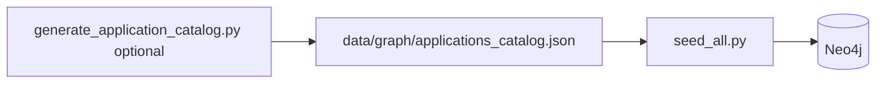
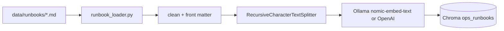
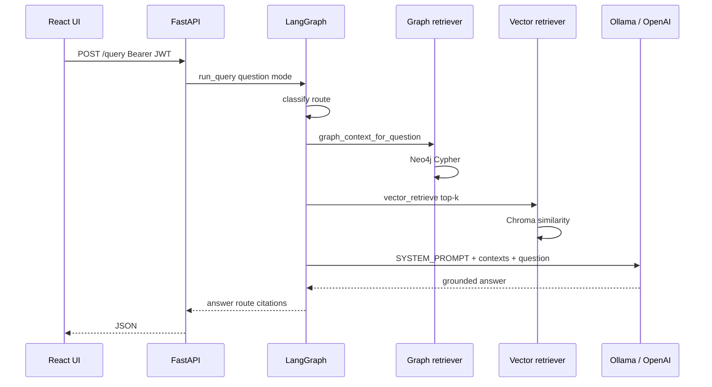

# Ops Center GraphRAG — Project Document

**Course:** The Gen Academy — Project 3 (GraphRAG for Organizational Knowledge)  
**Track:** LangChain + LangGraph (code-heavy)

---

## 1. Executive summary

**One-liner:** This RAG application helps **Ops Center engineers** answer **incident contact, dependency impact, escalation, and change-correlation questions** from an **enterprise knowledge graph (Neo4j) and runbook corpus (Chroma)** via a **secured web chat**, with evaluation against a **golden question set**.

**Problem:** In a large enterprise, hundreds of applications create incidents where ops must quickly find **who to call**, **what else breaks**, **whether a change is in flight**, and **how to format an SME escalation**—questions that mix **relationships** and **free-text procedures**.

**Approach:** **GraphRAG** for structured org/dependency/change data; **vector RAG** for runbooks; **LangGraph** to route, retrieve, and generate a **grounded** answer. **LLM:** Ollama (`llama3.2:3b` + `nomic-embed-text`) or OpenAI (configurable).

---

## 2. Data sources

| Source | Format | Location | Purpose |
|--------|--------|----------|---------|
| Application catalog | JSON + CSV | `data/graph/applications_catalog.json`, `applications_reference.csv` | 100 apps with description, tier, SME, Eng Manager, PM, Director, dependencies |
| Runbooks | Markdown | `data/runbooks/*.md` | Troubleshooting, L1 triage, SME templates, change ack procedures |
| Demo overlay | Cypher seed | `backend/app/graph/seed_catalog.py` | Active change requests, escalation levels, ops on-call contacts |
| Golden eval set | JSON | `eval/golden_dataset.json` | Expected keywords and preferred retrieval route per question |

---

## 3. Ingestion — Graph database (Neo4j)

### 3.1 What gets loaded

- **100 `Application` nodes** — name, description, domain, tier, criticality  
- **`Team` nodes** — one per domain; `(Team)-[:OWNS]->(Application)`  
- **`Person` nodes** — stakeholders per app:  
  - `(Person)-[:SME_FOR]->(Application)`  
  - `(Person)-[:ENG_MANAGER_FOR]->(Application)`  
  - `(Person)-[:PRODUCT_MANAGER_FOR]->(Application)`  
  - `(Person)-[:DIRECTOR_FOR]->(Application)`  
- **`DEPENDS_ON` edges** — blast radius between applications  
- **Overlay data** — `ChangeRequest` → `AFFECTS` → apps; `EscalationLevel` chain; ops `PRIMARY_CONTACT_FOR` on key Tier-0 apps  

### 3.2 Ingestion flow



**Steps:**

1. **Generate catalog (optional refresh)**  
   ```bash
   cd backend && PYTHONPATH=. python -m app.scripts.generate_application_catalog
   ```  
   Writes JSON + CSV under `data/graph/`.

2. **Load into Neo4j** — `seed_applications_and_stakeholders()` runs parameterized Cypher (`UNWIND $apps`) from `backend/app/graph/seed_catalog.py`.

3. **Full seed (graph + vectors)**  
   ```bash
   docker compose exec api python -m app.scripts.seed_all
   ```  
   - Clears graph (`MATCH (n) DETACH DELETE n`)  
   - Loads 100 applications + overlay  
   - Then ingests runbooks into Chroma (see §4)

**Verify:**

```bash
docker compose exec neo4j cypher-shell -u neo4j -p "$NEO4J_PASSWORD" \
  "MATCH (a:Application) RETURN count(a);"
# Expected: 100
```

**Example stakeholder query:**

```cypher
MATCH (a:Application {name: 'PaymentGateway'})
OPTIONAL MATCH (sme:Person)-[:SME_FOR]->(a)
OPTIONAL MATCH (dir:Person)-[:DIRECTOR_FOR]->(a)
RETURN a.description, sme.name, dir.name;
```

### 3.3 Graph retrieval at query time (no re-ingestion)

The API does **not** re-load JSON on each question. `backend/app/graph/retriever.py`:

1. Detects **application name** in the user question (longest match from 100-app catalog).  
2. Runs **Cypher templates** for profile, dependencies, upstream callers, active changes, escalation levels.  
3. Returns a **text context block** for the LLM plus structured records for citations.

---

## 4. Ingestion — Vector database (Chroma)

### 4.1 What gets loaded

Markdown **runbooks** (procedures, per-app troubleshooting). Each file may include YAML front matter:

```yaml
---
title: PaymentGateway Troubleshooting Runbook
doc_type: runbook
application: PaymentGateway
version: "3.1"
---
```

### 4.2 Ingestion pipeline



| Step | Module | Details |
|------|--------|---------|
| Load | `app/ingestion/runbook_loader.py` | Read `.md`; skip `_`-prefixed files |
| Clean | Same | Strip HTML comments; normalize blank lines |
| Metadata | Front matter | `source`, `title`, `application`, `doc_type` |
| Chunk | `app/ingestion/pipeline.py` | ~600 chars, 80 overlap; split on `##` / `###` |
| Embed | `app/rag/embeddings_factory.py` | Provider from env: `EMBEDDING_PROVIDER=ollama` or `openai` |
| Index | `app/rag/vector_store.py` | `rebuild_vector_index()` — deletes collection, avoids duplicates |

**Commands:**

```bash
# Vectors only (after editing runbooks)
docker compose exec api python -m app.scripts.ingest_runbooks

# Graph + vectors
docker compose exec api python -m app.scripts.seed_all
```

**Verify:** After seed, log shows e.g. `Chroma chunks indexed: 24`.

**Storage:** Docker volume `chroma_data` → `/data/chroma` in the API container.

Details: [ingestion.md](ingestion.md).

---

## 5. Runtime — What happens when ops submits a prompt

### 5.1 User journey

1. Engineer opens **http://&lt;host&gt;:5173** and logs in (JWT).  
2. Chooses mode: **Auto**, **Graph only**, or **Vector only**.  
3. Enters an incident question (e.g. *“PaymentGateway is down — who do I contact and is there an active change?”*).  
4. UI `POST /api/query` → FastAPI validates JWT → invokes LangGraph agent.  
5. Response shows **answer**, **route** used, and retrieved context in the API payload (for debugging).

### 5.2 LangGraph pipeline



**Nodes** (`backend/app/rag/graph_agent.py`):

| Node | Behavior |
|------|----------|
| **classify** | If mode is `auto`, use keyword heuristics: “who / depend / change” → graph or hybrid; “how / procedure / template” → vector or hybrid |
| **retrieve_graph** | Build `=== GRAPH CONTEXT ===` from Neo4j |
| **retrieve_vector** | Build `=== VECTOR CONTEXT ===` from Chroma (k=4) |
| **generate** | LLM with strict system prompt: answer **only** from context; structure contacts, blast radius, changes, SME fields; cite `[Graph]` / `[Vector]`; refuse if insufficient |

**System prompt intent:** Reduce hallucination during incidents; force ops-relevant sections (contacts → dependencies → changes → procedures).

### 5.3 Example routing

| Question | Typical route | Primary source |
|----------|---------------|----------------|
| Who is the SME for OrderService? | graph | Neo4j `SME_FOR` |
| What depends on AuthService? | graph | `DEPENDS_ON` |
| Active CR on PaymentGateway? | graph | `ChangeRequest` |
| Fields in SME L2 report? | vector | Runbook chunk |
| PaymentGateway incident — contacts + change + ack | hybrid | Graph + runbook |

### 5.4 Configuration (LLM)

Set in `backend/.env` (see [ollama-ec2.md](ollama-ec2.md)):

```env
LLM_PROVIDER=ollama
EMBEDDING_PROVIDER=ollama
OLLAMA_BASE_URL=http://10.135.128.9:11434
OLLAMA_MODEL=llama3.2:3b
OLLAMA_EMBEDDING_MODEL=nomic-embed-text
```

Diagnose:

```bash
docker compose exec api python -m app.scripts.diagnose_llm
```

---

## 6. Evaluation — Validating retrieval and answers

### 6.1 Purpose

Project 3 requires **GraphRAG vs vector RAG** comparison. We use a **golden dataset** with:

- Natural-language **questions** ops would ask  
- **`must_include`** keywords (ground truth snippets)  
- **`preferred_route`** — whether graph or vector retrieval should win on **retrieval context alone**  

This measures whether the **right knowledge** was fetched before judging LLM wording.

### 6.2 Golden dataset

File: **`eval/golden_dataset.json`** (13 cases including one out-of-scope / refusal case).

Each case:

```json
{
  "id": "q01",
  "question": "PaymentGateway is down — who should Ops contact first?",
  "preferred_route": "graph",
  "must_include": ["Alice Chen", "Payments Platform", "PaymentGateway"],
  "graph_entities": ["PaymentGateway", "Alice Chen"]
}
```

### 6.3 Metrics

**Retrieval score (per case, per channel):**

\[
\text{score} = \frac{\#\{\text{must\_include keywords found in retrieved context}\}}{|\text{must\_include}|}
\]

- **graph_retrieval_score** — keywords found in graph context string  
- **vector_retrieval_score** — keywords found in vector context string  
- **retrieval_winner** — graph, vector, or tie (higher score)

**Optional with LLM (`--with-llm`):**

- **answer_score** — keywords found in final generated answer  
- **route** — auto-routing choice  
- **refusal_ok** — for out-of-corpus questions, answer contains “cannot” / “could not find”

### 6.4 How to run evaluation

**Prerequisites:** `seed_all` completed; Neo4j + Chroma populated; LLM reachable (Ollama or OpenAI).

```bash
# Retrieval-only (fast, no LLM cost)
docker compose exec api python -m app.scripts.run_eval \
  --report /tmp/eval_report.json

# Retrieval + full GraphRAG answers (uses configured LLM — slower on 3B)
docker compose exec api python -m app.scripts.run_eval \
  --with-llm \
  --report /tmp/eval_report.json

# Copy report out if needed
docker compose cp api:/tmp/eval_report.json ./eval_report.json
```

**Example summary output:**

```json
{
  "summary": {
    "total": 13,
    "graph_retrieval_wins": 8,
    "vector_retrieval_wins": 4,
    "ties": 1
  }
}
```

### 6.5 Interpreting results

| Observation | Interpretation |
|-------------|----------------|
| Graph wins on ownership / deps / CR questions | GraphRAG design is working for structured queries |
| Vector wins on procedure / template questions | Runbook ingestion and chunking fit procedural RAG |
| Low scores on both | Missing data in graph or runbooks, or app name not detected in question |
| High retrieval score, low answer_score with `--with-llm` | LLM not staying grounded — tighten prompt or reduce context size |
| `refusal_ok: false` on q13 | Model hallucinated on out-of-scope question — document as failure mode |

Document **10 comparison queries** for submission in [comparison_analysis.md](comparison_analysis.md) (fill table from `eval_report.json`).

### 6.6 Manual validation (recommended for demo video)

1. **Graph:** *“Who is the director for SettlementService?”* — must match CSV/catalog.  
2. **Vector:** *“What mitigation does PaymentGateway runbook recommend for 502 during cert rotation?”* — expect DR-12 / secondary region.  
3. **Hybrid:** *“PaymentGateway incident — SME, director, and active change ack ticket.”*  
4. **Negative:** *“What is our SaaS pricing model?”* — should refuse (not in corpus).

Cross-check answers against:

- `data/graph/applications_reference.csv`  
- Raw runbook files in `data/runbooks/`  
- Neo4j Browser (SSH tunnel to 7474)

---

## 7. Operations reference

| Task | Command |
|------|---------|
| Full re-ingest | `docker compose exec api python -m app.scripts.seed_all` |
| Runbooks only | `docker compose exec api python -m app.scripts.ingest_runbooks` |
| Regenerate 100-app JSON/CSV | `docker compose exec api python -m app.scripts.generate_application_catalog` |
| LLM diagnostics | `docker compose exec api python -m app.scripts.diagnose_llm` |
| Eval | `docker compose exec api python -m app.scripts.run_eval --report /tmp/eval_report.json` |
| UI | http://&lt;host&gt;:5173 — `ops.alice` / `OpsCenter2026!` |

**After code changes on EC2:**

```bash
git pull && docker compose build --no-cache api && docker compose up -d --force-recreate api
```

---

## 8. Architecture pointers

- High-level design (diagrams): [README.md](../README.md#high-level-design)  
- EC2 (Amazon Linux 2023): [ec2-deploy.md](ec2-deploy.md)  
- Ollama (separate LLM host): [ollama-ec2.md](ollama-ec2.md)  
- RAG framework one-pager: [project_framework.md](project_framework.md)  

---

## 9. Submission checklist (Gen Academy)

- [ ] Google Doc or this document — overview, ingestion, prompt flow, eval results  
- [ ] Demo video (≤5 min): login → graph question → vector question → hybrid incident  
- [ ] GitHub link  
- [ ] Graph ≥20 nodes (we ship **100** applications)  
- [ ] GraphRAG vs vector comparison on **10+ queries** with analysis  

---

*Document version: October 2026 — Ops Center GraphRAG*
